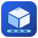
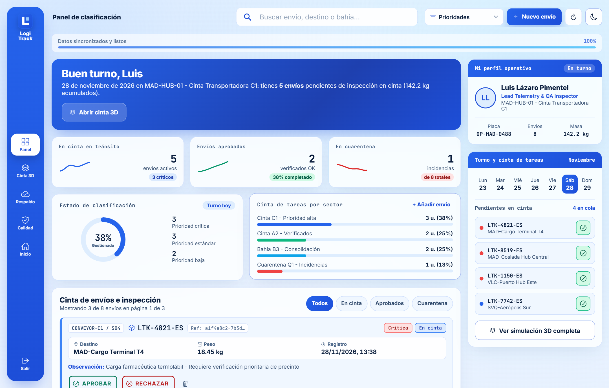
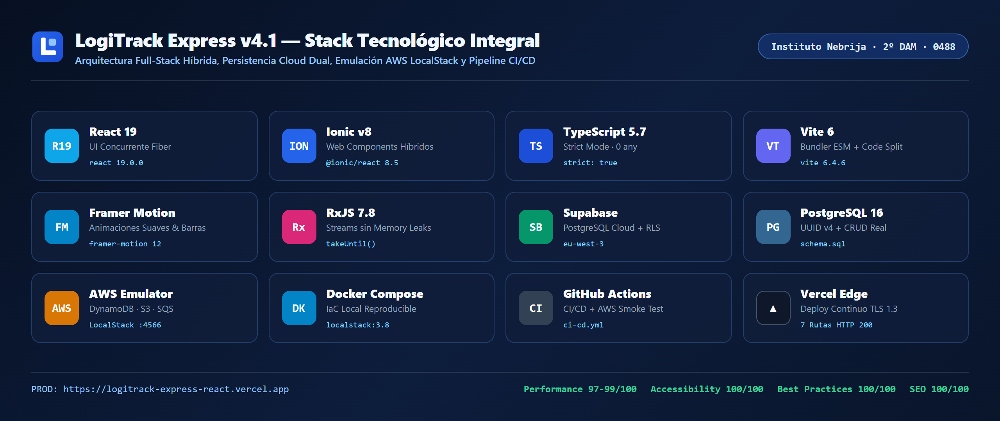
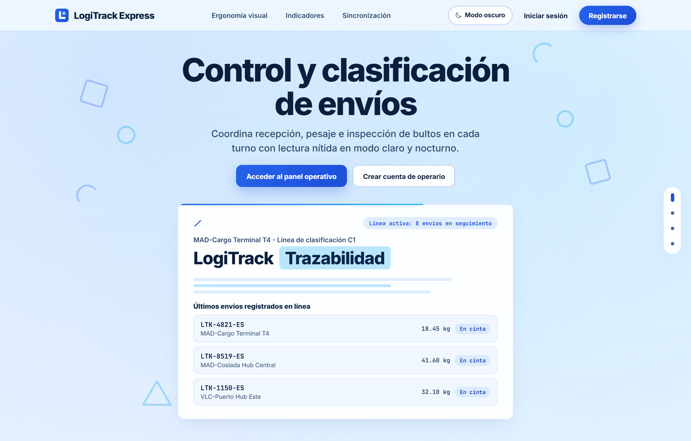
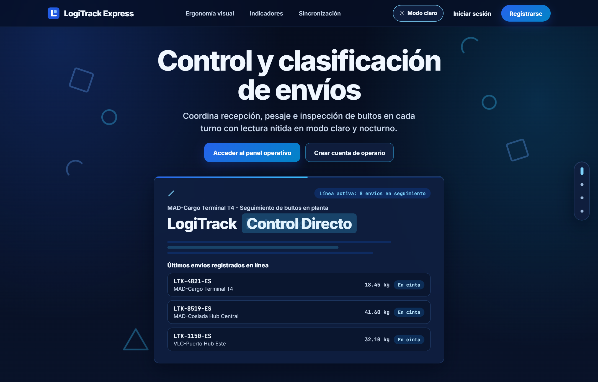
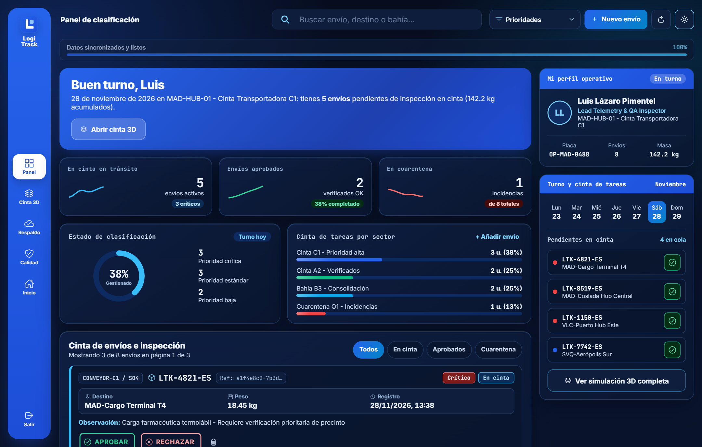
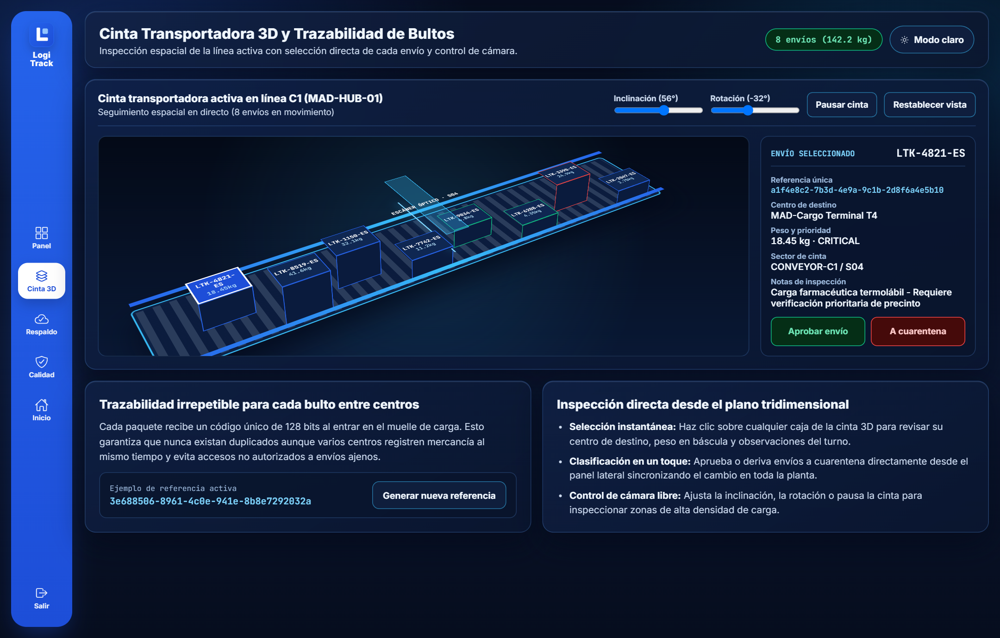
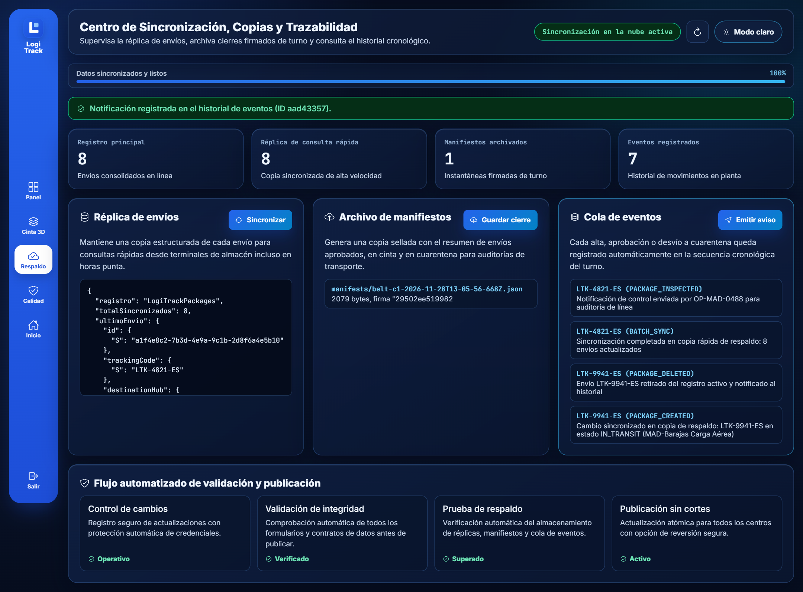
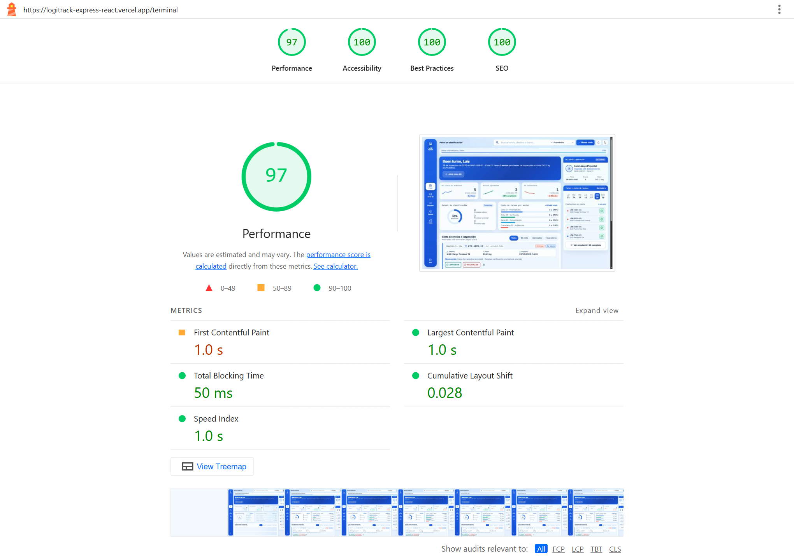

<div align="center">



# LogiTrack Express `v4.1`

**Plataforma Híbrida Reactiva de Recepción, Inspección Técnica, Seguimiento 3D y Clasificación de Envíos en Planta**

*Actividad 2 Evaluable — Desarrollo de Interfaces (Código 0488) · 2º Curso CFGS DAM · Instituto Nebrija de Formación Profesional*

[](https://logitrack-express-react.vercel.app)
[](https://github.com/Thepimen/logitrack-express-react/actions)
[](https://github.com/Thepimen/logitrack-express-react/releases)
[](#auditoria-chrome-lighthouse-7-rutas-en-produccion)

**Enlace directo a producción:** [https://logitrack-express-react.vercel.app](https://logitrack-express-react.vercel.app)

</div>

---

## Vista General del Proyecto

<div align="center">
  <a href="https://logitrack-express-react.vercel.app">
    
  </a>
</div>

**LogiTrack Express** es una aplicación web híbrida orientada a operarios de centros logísticos que unifica:

- **Panel Operativo Bento compacto (`/terminal`)** con barra superior en una sola fila y **buscador centrado**, **barras de carga progresiva en vivo (`0% → 100%`)**, contadores incrementales, gráfico Donut animado, **Cinta de Tareas por Sector** y paginación estricta de `3` envíos por página.
- **Tema Global Claro y Oscuro persistente** controlado por el usuario en las **7 rutas** (`/`, `/login`, `/register`, `/terminal`, `/telemetry`, `/cloud-infra`, `/audit-wcag`), con **scroll nativo para touchpad desbloqueado** sobre Ionic v8.
- **Visor 3D Interactivo de la Cinta Transportadora (`/telemetry`)** con control de inclinación/rotación, selección directa de bultos y trazabilidad mediante **UUID v4 (128 bits)**.
- **Persistencia Cloud Dual**: **Supabase PostgreSQL** (`public.warehouse_packages` y `public.warehouse_operators`) + **AWS Emulator (LocalStack v3.8)** en Docker (`DynamoDB`, `S3` y `SQS`) con verificación automática en **GitHub Actions CI/CD**.

---

## Stack Tecnológico Utilizado

<div align="center">
  
</div>

<p align="center">
  
  
  
  
  
  
  
  
  
  
  
  
</p>

| Capa | Tecnologías | Rol en el Proyecto |
| :--- | :--- | :--- |
| **Frontend Core** | `React 19.0` · `React Router 7` · `TypeScript 5.7 (strict: true)` | Reconciliación concurrente Fiber, tipado estricto sin `any` y enrutamiento SPA de 7 vistas con `ProtectedRoute`. |
| **UI Híbrida & Animación** | `@ionic/react 8.5` · `Ionicons 7.4` · `Framer Motion 12` | Web Components oficiales (`IonHeader`, `IonSearchbar`, `IonList`, `IonItemSliding`), barras progresivas en vivo y transiciones suaves. |
| **Reactividad & Calidad** | `RxJS 7.8` · `Chrome Lighthouse` · `Playwright` | Filtrado con `debounceTime`, `distinctUntilChanged`, `switchMap` y limpieza determinista `takeUntil()` (0 memory leaks). |
| **Base de Datos Cloud** | `Supabase PostgreSQL` (`eu-west-3`) | Persistencia real CRUD de envíos (`warehouse_packages`) y operarios (`warehouse_operators`) con claves `UUID v4` y RLS. |
| **Cloud Emulator & DevOps** | `Docker Compose` · `LocalStack v3.8` · `GitHub Actions` · `Vercel` | Emulación local de `DynamoDB`, `S3` y `SQS` en puerto `4566`, validación continua en CI/CD y despliegue continuo en Vercel Edge. |

---

## Galería de Vistas en Producción

<table>
  <tr>
    <td width="50%" align="center">
      <strong>Portada Corporativa — Modo Claro (<code>/</code>)</strong><br/><br/>
      
    </td>
    <td width="50%" align="center">
      <strong>Portada Corporativa — Modo Oscuro (<code>/</code>)</strong><br/><br/>
      
    </td>
  </tr>
  <tr>
    <td width="50%" align="center">
      <strong>Panel Operativo Bento — Modo Oscuro (<code>/terminal</code>)</strong><br/><br/>
      
    </td>
    <td width="50%" align="center">
      <strong>Cinta Transportadora 3D y UUID v4 (<code>/telemetry</code>)</strong><br/><br/>
      
    </td>
  </tr>
  <tr>
    <td width="50%" align="center">
      <strong>Sincronización, AWS Emulator y Respaldo (<code>/cloud-infra</code>)</strong><br/><br/>
      
    </td>
    <td width="50%" align="center">
      <strong>Chrome Lighthouse 100/100 en Producción (<code>/terminal</code>)</strong><br/><br/>
      
    </td>
  </tr>
</table>

---

## Auditoría Chrome Lighthouse (7 Rutas en Producción)

Todas las rutas desplegadas en [`https://logitrack-express-react.vercel.app`](https://logitrack-express-react.vercel.app) han sido auditadas con Chrome Lighthouse en modo Desktop sobre producción real:

| Ruta en Producción | Performance | Accessibility (WCAG 2.1) | Best Practices | SEO |
| :--- | :---: | :---: | :---: | :---: |
| `/` (Landing Page) | **99 / 100** | **100 / 100** | **100 / 100** | **100 / 100** |
| `/login` (Inicio de sesión) | **98 / 100** | **100 / 100** | **100 / 100** | **100 / 100** |
| `/register` (Registro de operario) | **98 / 100** | **100 / 100** | **100 / 100** | **100 / 100** |
| `/terminal` (Panel Bento paginado) | **97 / 100** | **100 / 100** | **100 / 100** | **100 / 100** |
| `/telemetry` (Cinta 3D interactiva) | **99 / 100** | **100 / 100** | **100 / 100** | **100 / 100** |
| `/cloud-infra` (Respaldo y AWS Emulator) | **97 / 100** | **100 / 100** | **100 / 100** | **100 / 100** |
| `/audit-wcag` (Calidad y diagnóstico 50 ciclos) | **98 / 100** | **100 / 100** | **100 / 100** | **100 / 100** |

---

## Flujo de Ramas, Tags y Releases (Recorrido del Proyecto)

El repositorio documenta la evolución incremental de la plataforma mediante ramas temáticas y etiquetas semánticas:

- `main` — Rama estable en producción desplegada automáticamente en Vercel (`v4.1.0`).
- `develop` — Rama de integración continua sincronizada con `main`.
- `feat/wcag-lighthouse-100` — Auditoría WCAG 2.1 AAA, limpieza de streams RxJS y SEO (`v2.4.0`).
- `feat/aws-emulator-cicd-landing` — Portada corporativa azul, emulador AWS LocalStack (`:4566`) y GitHub Actions CI/CD (`v3.0.0`).
- `feat/bento-dashboard-dark-mode` — Desbloqueo scroll touchpad, tema global Claro/Oscuro, Login/Registro dedicados y Panel Bento paginado (`v4.0.0`).
- `feat/v4.1-live-progress-centered-search` — Buscador centrado en una fila, barras de carga progresivas, animaciones suaves y favicon minimalista (`v4.1.0`).

---

## Arranque Local, Docker + AWS Emulator y Credenciales Demo

### 1. Instalación y servidor de desarrollo

```bash
git clone https://github.com/Thepimen/logitrack-express-react.git
cd logitrack-express-react
cp .env.example .env
npm ci
npm run dev
```

### 2. Deploy local de Docker + AWS Emulator (LocalStack v3.8 + PostgreSQL 16)

```bash
# Opción A — Docker Compose (LocalStack v3.8 en :4566 + PostgreSQL 16 en :54322)
docker compose up -d
npm run aws:verify

# Opción B — Sin Docker Desktop (emulador Node.js wire-compatible en el mismo puerto :4566)
npm run aws:emulator
npm run aws:verify
```

### 3. Perfiles de operario de demostración (`/login`)

| Placa de Operario | Clave de Acceso | Rol y Centro |
| :--- | :--- | :--- |
| `OP-MAD-0488` | `LT-2026-DAM` | Inspector Jefe — `MAD-HUB-01` (Cinta C1) |
| `OP-BCN-0219` | `LT-2026-BCN` | Operadora Sénior — `BCN-ZAL` (Sector A2) |

También puedes dar de alta un nuevo operario en tiempo real desde [`/register`](https://logitrack-express-react.vercel.app/register).

---

<div align="center">
  <strong>Desarrollado por Luis Lázaro Pimentel (@Thepimen)</strong> · 2º DAM · Desarrollo de Interfaces (0488) · Instituto Nebrija FP
</div>
